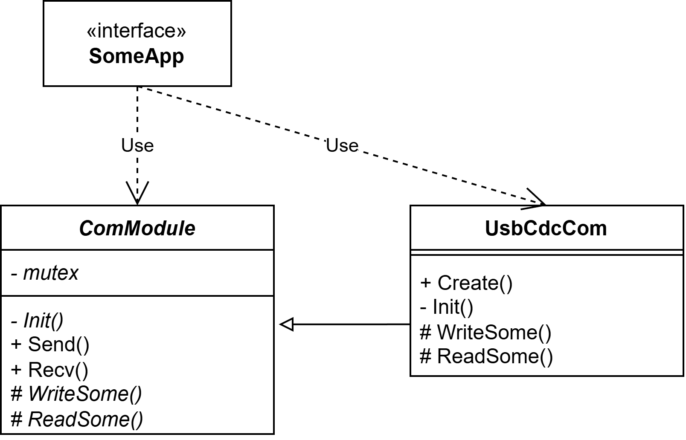

# 通信モジュール仕様設計

## 概要

- pico2wの通信インターフェースの仕様と設計を規定する
- ここでいう通信インターフェースは、PCとの純粋な送受信のことを指す。
  - デバッグトレースやコマンドなどのアプリケーション層とは切り離した概念であることに注意

## 共通設計


- `ComModule()`クラスを継承したそれぞれの子クラスで実装する。
- 子クラスではファクトリーパターンでインスタンスを生成させる。提供可能なインターフェース数以上にインスタンス生成するのを防ぐため。
- 各インスタンスごとにFreeRTOSの優先度継承mutexを保持する。
- タスクスケジューラ起動前に呼び出した場合は、mutexとtask yieldをスキップする

### API

```c++
enum class ComStatus { // 送受信関数の戻り値
        Ok,
        Timeout,
        NotConnected,
        ArgErr,
        TransportErr
    };

class ComModule {
public:
    virtual ~ComModule() = default;
    virtual bool Init() = 0;
    ComStatus Send(				// 戻り値: ComStatus
    	const uint8_t* data,	// 送信データのポインタ
    	size_t data_len,		// 送信データバイト数
    	uint32_t timeout_ms,	// タイムアウト値
        size_t* sent_len		// 実際に送信したバイト数
    );
    ComStatus Recv(				// 戻り値: ComStatus
    	uint8_t* data,			// 受信バッファのポインタ
    	size_t data_len,		// 受信バッファのサイズ
    	uint32_t timeout_ms,	// タイムアウト値
        size_t* recv_len		// 実際に受信したバイト数
    );
protected:
   virtual int32_t WriteSome(	// Send()で呼ぶノンブロッキング関数, 送信バイト数/エラー(負)を返す
   		const uint8_t* data,
   		size_t data_len
   ) = 0;
    virtual int32_t ReadSome(	// Recv()で呼ぶノンブロッキング関数, 受信バイト数/エラー(負)を返す
    	uint8_t* data,
    	size_t data_len
    ) = 0;
};
```

- `Send()/Recv()` で共通処理をしたのち、通信IFごとの処理を`WriteSome()/ReadSome()` で実施する設計。`WriteSome()/ReadSome()`は即抜けし、`Send()/Recv()` 側でタイムアウトを管理する。
- タイムアウトはpico-sdkのタイマーで管理する。
- `WriteSome()/ReadSome()`で送受信失敗時の戻り値は、0: 待ち, -1: 切断, -2: 送受信エラー とする。
- `ComModule()`での送受信関数は**割り込みコンテキストでは使用不可**とする。
- `timeout_ms`に0を指定した場合はノンブロッキングで動作し、`UINT32_MAX`を指定した場合は無限待ちする。
- `sent_len`/`recv_len`は`nullptr`を許容する。

## USB CDC

- TinyUsb CDC層のAPIを呼び出して実装する。include headerは `tusb.h`
- この層は、ボードのFIFOバッファに書き込み/読み出しするAPIを提供する。
- 実際の送受信は、`tud_task()`によって実行される。

### Create()

- CDCは単一インターフェースしかないため、二つ目のインスタンスを生成しようとしたら`ASSERT()`させる。
- `Create()`内で、`Init()`も行い、使用可能な状態で戻り値に入れる。
- `Init()`では、`tud_inited()`の確認のみ行う。`stdio_usb_init()`は起動時の初期化処理でを呼ばれており、2度目の呼び出しは未定義のため。

### WriteSome()

- `bool tud_cdc_connected()` で送信可能かチェックする。未接続の場合は-1を返す。
- `uint32_t tud_cdc_write(const void*, uint32_t)`でFIFOに書き込む。
- `uint32_t tud_cdc_write_flush()`でFIFOからエンドポイントへ発送する。
- `WriteSome()`の戻り値は、送信FIFOに積んだバイト数なので、`tud_cdc_write()`の戻り値。

> [!note]
>
> - `tud_cdc_write_flush()`を呼ばないと、64BたまるまでFIFOからは送出されない。

### ReadSome() TBD

> [!note]
>
> - 必要に応じて実装予定